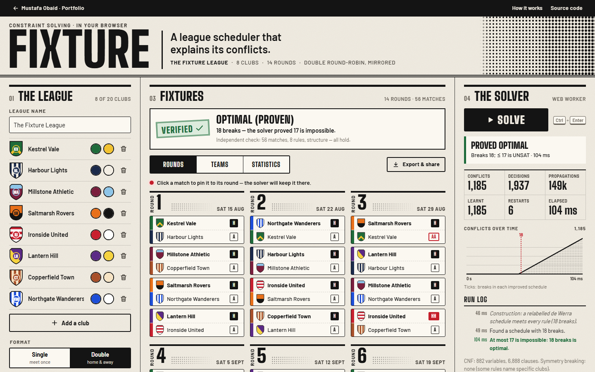

# Fixture — a league scheduler that explains its conflicts

A conflict-driven clause-learning (CDCL) SAT solver, written from scratch in TypeScript, schedules a
whole round-robin season in your browser, proves the minimum number of breaks — and when the rules are
impossible, names the smallest set of rules to blame.

**[Live demo](https://mustafaobaidd1.github.io/fixture-league-scheduler/)**



## The question

Can a whole season be scheduled so that every club's constraints hold — and if it is impossible,
which constraints are to blame?

A real fixture list has to respect grounds that are unavailable on certain dates, derbies that must
fall on the last day, clubs that share a stadium, clubs that must not meet early, limits on how many
home or away games come in a row — and, ideally, as few _breaks_ (two home or two away games in a row)
as possible. With a dozen such rules some combinations are contradictory, and "no solution found" is
useless to the person who has to fix it. Fixture answers with a schedule that is independently
verified, a proof that no schedule has fewer breaks, or a minimal set of rules that cannot all hold,
in plain language, each with a one-click way to relax it.

## Features

- **League setup**: 2–20 clubs (an odd number gives every club byes), names, colours, an original
  geometric crest generated from initials and colours, single or double round-robin (mirrored or
  free), first matchday and days between rounds.
- **Nine kinds of rule**, each a card with an on/off switch and a plain-language sentence you edit in
  place: home, away or "ground unavailable" in round _r_ · must rest in round _r_ · fixed match (host,
  visit or either venue; "the final round" for a last-day derby) · at most _k_ home or away games in a
  row · fewest breaks (the objective) · a cap on breaks, in total or per club · two clubs sharing a
  ground are never both at home · selected clubs do not meet in the first _k_ rounds · no club starts
  or ends with two home or two away games.
- **Solving in a Web Worker** with live statistics (conflicts, decisions, propagations, learnt
  clauses, restarts, elapsed time), a chart of conflicts over time with a tick for every improved
  schedule, a run log, and a Cancel button. A 20-second limit returns the best schedule found so far,
  with a "keep searching" button.
- **Optimal (proven)**: break minimisation by bound tightening; the label appears only when "at most
  _B_ − 1 breaks" comes back UNSAT. An independent RUP checker then re-derives every learnt clause of
  that proof in the browser.
- **Explain infeasibility**: "These _N_ constraints cannot all hold" — a minimal unsatisfiable subset
  of your rules, the structural rule of a round-robin it relies on (e.g. "every team plays in every
  round"), the breaks theorem when a cap is below it, and one-click relax actions that re-solve.
- **Independent validator**: separate code re-checks every schedule shown against the round-robin
  structure and every active rule; each rule card carries its tick or cross.
- **Views**: a round grid of match tickets (click or press Enter to pin a match to its round), a
  per-club strip of home/away patterns with breaks joined in red, and statistics (breaks per club,
  home/away balance, breaks by round, theoretical minimum).
- **Export and share**: CSV fixture list, one ICS calendar per club (or all of them as a ZIP), and the
  whole setup in the URL hash.
- **Keyboard**: every match ticket and strip cell is focusable (arrow keys move, Enter pins), rule
  cards are native checkboxes and selects, Ctrl/⌘ + Enter solves from anywhere.

## How it works

### Model

With _n_ clubs a dummy club is added when _n_ is odd — playing it is a bye — so _N_ is even and each
leg has _R_ = _N_ − 1 rounds. The CNF formula uses

- $m_{p,r}$: pair $p = \{i, j\}$ meets in round $r$;
- $h_{t,r}$: club $t$ plays at home in round $r$;
- $b_{t,r}$: club $t$ has a **break** in round $r$ — its second consecutive home (or away) game. A bye
  interrupts a run, so with byes a club can alternate perfectly.

Structural rules: each club (and the dummy) plays exactly once per round; every pair meets exactly
once per leg (in a free double round-robin, every club hosts every other club exactly once, through
auxiliary "_i_ hosts _j_ in round _r_" variables); and $m_{ij,r} \rightarrow (h_{i,r} \oplus h_{j,r})$.
A mirrored second half costs no clauses at all: it reuses the first half's variables with
$m_{p,r+R} = m_{p,r}$ and $h_{t,r+R} = \lnot h_{t,r}$.

Every user rule gets a **selector** literal $s$; its clauses become $(\lnot s \lor \dots)$, so it is
switched on by solving under the assumption $s$.

### Cardinality encodings

- **Exactly-one**: an at-least-one clause plus pairwise exclusions for groups of up to 8 literals, a
  ladder (sequential) encoding above that.
- **At most _k_** (per-club break caps): Sinz's sequential counter, registers $s_{i,j}$ = "at least $j$
  of the first $i$ inputs", clauses $x_i \land s_{i-1,j-1} \rightarrow s_{i,j}$ and the overflow clause
  $\lnot x_i \lor \lnot s_{i-1,k}$.
- **Total breaks**: a totalizer (Bailleux & Boufkhad) — a tree of unary adders whose outputs satisfy
  $o_k \Leftarrow \sum b_i \ge k$; merging children $a, b$ adds $\lnot a_i \lor \lnot b_j \lor r_{i+j}$.
  Assuming $\lnot o_{k+1}$ means "at most $k$ breaks". Mirrored seasons feed each first-half break in
  twice.

Only the clauses that restrict inputs carry the selector; definitional clauses are always satisfiable,
so a guarded constraint really disappears when its selector is false. Every encoding is tested
against brute force over all input assignments for _n_ ≤ 7.

### The CDCL solver

- Unit propagation with **two watched literals** and a cached blocker literal per watch; two-literal
  clauses live in implication lists.
- **Conflict analysis with first-UIP learning** and recursive learnt-clause minimisation.
- **Non-chronological backjumping** to the second-highest decision level of the learnt clause.
- **VSIDS** branching: activities bumped by an increment that grows by 1/0.95 per conflict, decisions
  taken from a binary heap.
- **Phase saving**, **Luby restarts** (100 × luby(_i_) conflicts) and **clause deletion** ranked by
  literal block distance, keeping glue clauses (LBD ≤ 2).
- **Assumptions and final conflicts**: the solver reports which assumptions an UNSAT answer depends
  on; this core drives both optimisation proofs and explanations.
- **Proof logging**: every learnt clause is recorded, so an independent checker can replay it.

### Getting a good schedule fast

- **Construction.** De Werra's canonical factorisation has the fewest breaks possible, and so does any
  copy of it with clubs relabelled, venues swapped or rounds reversed. A short local search over those
  transformations (and round rotations), scored by the validator — broken rules first, then breaks —
  picks the copy that fits the rules best. Its values become the solver's saved phases: a hint, never
  a constraint. In the example league it meets all eight rules with 18 breaks.
- **Symmetry breaking** when every club is interchangeable: clubs are relabelled so club 1 meets club
  _r_ + 1 in round _r_ (single and mirrored formats) or round 1 pairs (1,2), (3,4), … (free double),
  and if no rule depends on venues, club 1 is away in round 1. Ordering the home/away rows of partly
  interchangeable clubs lexicographically is also valid but was measured unreliable (up to 9× faster
  or slower, and it stalled feasibility on 20-club free seasons), so it is not used.
- **Bound tightening.** After a schedule with _B_ breaks, solve again assuming "at most _B_ − 1". When
  that is UNSAT the result is **Optimal (proven)**. If the incumbent already equals a proven lower
  bound (below) but the solver's own proof would take longer than 3 s, the result is labelled
  **Optimal** and says it rests on the theorem.
- **Large-neighbourhood search** on big leagues: when a full step stalls for 1.5 s, the pairings
  outside a window of rounds are pinned by assumptions (venues stay free) and the solver looks for
  fewer breaks inside it; when windows stop helping, a full call gets the remaining time, since only a
  full call can prove optimality.

### Explanations: cores and minimal unsatisfiable subsets

When the selectors cannot all be assumed, the final conflict is a core. Deletion-based extraction
tries dropping each member: if the rest is still UNSAT the member goes, and the smaller core of that
call replaces the set (clause-set refinement); if the rest becomes satisfiable the member is
necessary. The result is minimal — removing any one rule makes the others satisfiable. A second pass
rebuilds the formula with selectors on the structural rules too (mirroring becomes explicit
equivalences) and minimises those, which is how the explanation can say "together with: in every
match one team is at home and the other away".

### The breaks theorem

A club without breaks alternates home and away, and there are only two such patterns. Two clubs with
the same pattern are always at the same venue and could never play each other, so at most two clubs
avoid breaks: any season with _n_ (even) clubs needs at least _n_ − 2 breaks. De Werra (1981) showed
this is exact for a single round-robin, and that a mirrored double round-robin needs $3n - 6$. With
an odd number of clubs the byes let everyone alternate.

### Independent checks

- `src/validate/validate.ts` never sees a variable or clause: it reads plain matches and re-derives
  structure, rules and breaks.
- `src/proof/rup.ts` replays the proof log with its own unit propagation (separate data structures, no
  shared code with the solver): each lemma must follow by reverse unit propagation, and finally the
  negation of the core.

## Validation

**Kind of tool:** a working planner. Every schedule it shows is verified by the independent validator.
Optimality and infeasibility rest on the solver's UNSAT answers; the app re-checks those proofs with
the RUP checker when they fit in a few seconds, and says so when they do not. A checked proof certifies
the CNF formula; that the formula matches the rules is established by tests against exhaustive
enumeration, not by a formal proof.

Unit tests (`npm test`, 98 tests):

- **Solver**: unit propagation, small SAT/UNSAT cases, pigeonhole PHP(_n_ + 1, _n_) UNSAT for
  _n_ ≤ 7 (RUP-certified for _n_ ≤ 5), 300 random 3-SAT instances at _m_/_n_ = 4.26 with _n_ = 20
  agreeing with a bitset brute force, every model checked against every clause, cores of random
  formulas UNSAT on their own, incremental use, budgets and progress.
- **Encodings**: pairwise and ladder at-most-one, exactly-one, sequential counter at-most-_k_ /
  at-least-_k_ / exactly-_k_, and the totalizer — all equal to brute force over every input assignment
  for _n_ ≤ 7, including guards.
- **Breaks theorem**: the optimiser finds _n_ − 2 for _n_ = 4…12 by search alone (no warm start, no
  theory shortcut) and proves _n_ − 3 infeasible, RUP-certified for _n_ ≤ 10; mirrored seasons prove
  3_n_ − 6 for _n_ = 4, 6, 8; odd counts need 0; symmetry breaking never changes an optimum.
- **Exhaustive cross-check**: on every 3- and 4-club format (single, mirrored, free) with random rule
  sets, feasibility and the optimum agree with enumeration of every schedule (384 for 4 clubs single,
  5,760 for 4 clubs free) checked by the validator; every explanation is infeasible by enumeration and
  minimal (dropping any member makes enumeration find a schedule).
- **Validator**: accepts the _n_ = 6 schedule of Rasmussen & Trick's survey (Fig. 6) with exactly 4
  breaks; de Werra's canonical schedules have _n_ − 2 (single), 3_n_ − 6 (mirrored) and 2_n_ − 4
  (reversed second half) breaks for _n_ up to 20; property tests on random valid and corrupted
  schedules name the broken rule.
- **Exports**: RFC 5545 folding by octets, escaping, CRLF and UIDs; RFC 4180 quoting; ZIP structure
  and CRC-32 check value; share links round-trip and reject damaged input.

End-to-end tests (`npm run test:e2e`, 18 tests × desktop and mobile): the example solves to a
verified, certified optimum; contradictory rules added through the UI give exactly the 3-rule
explanation and relaxing one re-solves; pinning; ICS (14 VEVENTs) and CSV downloads; share-link round
trip; damaged links; invalid input; keyboard solve and pin; views; the dialog; the worker-less
fallback; axe (WCAG 2.2 AA) in the solved, team-strip, statistics, rules, league, dialog and
explanation states.

`npm run validate` (Node 24, recorded 2026-10-07; times vary with machine load):

**Single round-robin: minimum breaks**

| n   | theory n − 2 | found | ≤ n − 3                  | time   | RUP check                                 |
| --- | ------------ | ----- | ------------------------ | ------ | ----------------------------------------- |
| 4   | 2            | 2     | UNSAT (6 conflicts)      | 10 ms  | ✓ 6 lemmas, 2 ms                          |
| 6   | 4            | 4     | UNSAT (263 conflicts)    | 16 ms  | ✓ 263 lemmas, 13 ms                       |
| 8   | 6            | 6     | UNSAT (1,145 conflicts)  | 42 ms  | ✓ 1,145 lemmas, 44 ms                     |
| 10  | 8            | 8     | UNSAT (9,104 conflicts)  | 282 ms | ✓ 9,104 lemmas, 722 ms                    |
| 12  | 10           | 10    | UNSAT (46,581 conflicts) | 1.51 s | ✓ 46,581 lemmas, 7.73 s                   |
| 14  | 12           | 12    | UNSAT (71,727 conflicts) | 2.40 s | ✓ 71,727 lemmas, 13.77 s                  |
| 16  | 14           | 14    | UNSAT (94,393 conflicts) | 4.60 s | The proof is too large to keep in memory. |

**Mirrored double round-robin: minimum breaks**

| n   | theory 3n − 6 | proven optimum | time   | RUP check |
| --- | ------------- | -------------- | ------ | --------- |
| 4   | 6             | 6              | 1 ms   | ✓         |
| 6   | 12            | 12             | 19 ms  | ✓         |
| 8   | 18            | 18             | 58 ms  | ✓         |
| 10  | 24            | 24             | 479 ms | ✓         |
| 12  | 30            | 30             | 1.27 s | ✓         |

**Other formats (proven by the solver, no theory used)**

| league                 | minimum breaks | proof   | time   |
| ---------------------- | -------------- | ------- | ------ |
| single, n = 3          | 0              | trivial | 1 ms   |
| single, n = 5          | 0              | trivial | 1 ms   |
| single, n = 7          | 0              | trivial | 2 ms   |
| single, n = 9          | 0              | trivial | 137 ms |
| single, n = 11         | 0              | trivial | 1.02 s |
| mirrored double, n = 3 | 1              | solver  | 0 ms   |
| mirrored double, n = 5 | 3              | solver  | 3 ms   |
| mirrored double, n = 7 | 5              | solver  | 76 ms  |
| mirrored double, n = 9 | 7              | solver  | 577 ms |
| free double, n = 4     | 2              | solver  | 1 ms   |
| free double, n = 6     | 4              | solver  | 17 ms  |
| free double, n = 8     | 6              | solver  | 118 ms |
| free double, n = 10    | 8              | solver  | 1.57 s |

**Pigeonhole**

| instance  | answer | conflicts | time   | RUP check |
| --------- | ------ | --------- | ------ | --------- |
| PHP(4, 3) | unsat  | 7         | 0 ms   | ✓ 0 ms    |
| PHP(5, 4) | unsat  | 28        | 0 ms   | ✓ 1 ms    |
| PHP(6, 5) | unsat  | 150       | 1 ms   | ✓ 2 ms    |
| PHP(7, 6) | unsat  | 788       | 5 ms   | ✓ 14 ms   |
| PHP(8, 7) | unsat  | 4,743     | 72 ms  | ✓ 200 ms  |
| PHP(9, 8) | unsat  | 24,672    | 693 ms | ✓ 6.08 s  |

**Random 3-SAT, n = 20, m = 85**

| instances | agree with brute force | SAT | UNSAT | mean solve time |
| --------- | ---------------------- | --- | ----- | --------------- |
| 1000      | 1000                   | 723 | 277   | 0.07 ms         |

**As the app runs them (20 s limit, warm start, LNS, theory bound)**

| league                                     | result               | time                           | RUP check      |
| ------------------------------------------ | -------------------- | ------------------------------ | -------------- |
| Example: 8 clubs, mirrored double, 8 rules | optimal (solver), 18 | 65 ms                          | ✓ 1,185 lemmas |
| 20 clubs, single + 5 rules                 | optimal (theory), 18 | 3.03 s (first schedule 24 ms)  | —              |
| 20 clubs, mirrored double + 5 rules        | optimal (theory), 54 | 3.05 s (first schedule 23 ms)  | —              |
| 20 clubs, free double + 5 rules            | timeout, best 36     | 20.00 s (first schedule 65 ms) | —              |

The _n_ = 16 proof (94,393 lemmas) exceeds the proof log's memory cap, so it is not re-checked. In the
last table "theory" means the incumbent equals de Werra's lower bound and the solver's own proof was
cut off after 3 s; the free double round-robin with 20 clubs is not settled within 20 s (lower bound
18).

## Limitations

- Breaks are the only objective. Travel distance, television slots, stadium capacity and kick-off
  times are out of scope; rounds are dated by a fixed interval.
- Breaks are counted between consecutive rounds and a bye interrupts a run. Other conventions exist
  (some count H–bye–H as a break).
- Big leagues with many rules may not be proven optimal within 20 s; the best schedule is then shown
  without an optimality claim (and, when it applies, with the theoretical lower bound for reference).
  For free double round-robins only the bound _n_ − 2 is known; the solver proves it is attained for
  _n_ ≤ 10.
- The construction, LNS and the 20 s budget depend on time slices, so on big leagues the result can
  differ between runs and machines. Small leagues (like the example) are solved deterministically,
  which is why share links carry only the setup.
- Proof checking is forward RUP inside the browser with a few seconds' budget; long proofs are
  reported as unchecked rather than checked.
- Explanations are minimal (no rule can be dropped), not minimum (another, smaller conflicting set may
  exist).

## Prior art

- **[LeagueLobster](https://www.leaguelobster.com/)** and many other hosted fixture generators build
  schedules with rules for availability and venues; their public documentation does not describe
  explaining infeasible rule sets. Fixture is open source, runs entirely in the browser and returns a
  minimal set of conflicting rules.
- **Google OR-Tools** ships a CP-SAT sports-scheduling example that models breaks with Boolean
  variables; CP-SAT is a far stronger industrial solver. Fixture's solver is small and written from
  scratch, so every step (stats, proofs, cores) can be shown.
- **RobinX** (Van Bulck, Goossens, Schönberger & Guajardo, EJOR 2020) classifies round-robin
  timetabling constraints and provides an XML format and validator, used by the ITC2021 competition.
  Fixture's rules correspond to a small subset (capacity, game, break and separation constraints) in
  its own format.
- **Bartsch, Horbach & Briskorn** ("Using a SAT-solver to schedule sports leagues", J. Scheduling 2012) scheduled real leagues by reduction to SAT. **Reprobate** (Lester, J. Scheduling 2022) encodes
  RobinX instances as pseudo-Boolean problems. Fixture applies the same idea at browser scale and adds
  minimal explanations and proof checking.
- **MUS and explanation tools** such as MUSer2, MARCO and QuickXplain extract minimal unsatisfiable
  subsets for general formulas or constraint models; Fixture maps one onto named, editable rules.
- **In-browser SAT**: `logic-solver` (MiniSat compiled to JavaScript with Emscripten) and WebAssembly
  builds of CaDiCaL. None of them is used here; the solver is this project's own code.

## Tech stack and architecture

Vite 8, React 19, TypeScript 6 (strict), Vitest 5, Playwright 1.63, ESLint 10. No runtime
dependencies beyond React and self-hosted fonts.

```
src/solver/    CDCL solver, cardinality encodings, CNF/DIMACS helpers
src/proof/     proof log and the independent RUP checker
src/model/     setup types, season shape, input checks, presets, de Werra construction
src/encode/    league → CNF (selectors, breaks, totalizer, symmetry breaking, LNS pins)
src/engine/    feasibility, optimisation, construction seed, LNS, MUS, certification
src/validate/  independent schedule validator (+ brute-force enumerator for tests)
src/export/    CSV, ICS, ZIP, share-link codec
src/worker/    Web Worker entry and client (with a main-thread fallback)
src/ui/, src/app/  React interface, state and hooks
```

The solver runs in a module Web Worker, streams statistics with `postMessage` while it searches, and
is cancelled by terminating the worker. Without workers the same engine runs on the page in short
slices (a notice says so).

## Run locally

```sh
npm install
npm run dev          # http://localhost:5305/fixture-league-scheduler/
npm test             # unit tests
npm run test:e2e     # Playwright, desktop + mobile (builds are served by vite preview on 5405)
npm run build
npm run validate     # slower validation tables
npm run screenshots  # README screenshots and the social image (after npm run build)
npm run check        # lint, typecheck, format, unit, build, e2e
```

## Accessibility notes

- One `<h1>`, landmarks, labelled controls; rule sentences are native selects and inputs; switches are
  checkboxes with `role="switch"`.
- The fixture grid and team strips use roving focus: Tab enters once, arrow keys move, Enter or Space
  pins a match; a skip link jumps to the fixtures; Ctrl/⌘ + Enter solves.
- Solver results and pins are announced through an `aria-live` region; the explanation is a labelled
  region.
- Meaning never relies on colour alone: breaks read **HH**/**AA**, venues **H**/**A**, rule states
  "Holds"/"Broken"/"In conflict".
- Text contrast is at least 4.5:1 (ink, signal red, green and amber were measured on the paper colour);
  crest initials pick ink, white or black for ≥ 4.5:1 on any team colour.
- `prefers-reduced-motion` removes the grid stagger and all transitions; motion is only feedback.
- Touch targets for primary controls are at least 44 × 44 px; the phone layout keeps Solve in a bottom
  bar within reach of a thumb.
- axe (WCAG 2.2 AA) runs in the end-to-end tests across seven states, on desktop and mobile.

## Credits & licences

- **Fonts** (self-hosted via [Fontsource](https://fontsource.org/), Latin subset): Big Shoulders
  Display (designed by Patric King for The Big Shoulders Project) and Barlow (The Barlow Project
  Authors, Jeremy Tribby), both under the SIL Open Font License 1.1.
- **Algorithms and references**: D. de Werra, "Scheduling in sports", _Annals of Discrete Mathematics_
  11 (1981) 381–395 · R. V. Rasmussen & M. A. Trick, "Round robin scheduling — a survey", _EJOR_ 188
  (2008) · J. P. Marques-Silva & K. A. Sakallah, GRASP (1999) · M. Moskewicz et al., Chaff (DAC 2001)
  · N. Eén & N. Sörensson, "An extensible SAT-solver" (SAT 2003) · G. Audemard & L. Simon, Glucose
  (IJCAI 2009) · K. Pipatsrisawat & A. Darwiche, phase saving (SAT 2007) · M. Luby, A. Sinclair & D.
  Zuckerman (1993) · C. Sinz, sequential counter (CP 2005) · O. Bailleux & Y. Boufkhad, totalizer (CP
  2003).
- Club names, colours and crests are fictional and generated for this project; no third-party data is
  used.

## License

MIT — see [LICENSE](LICENSE).
